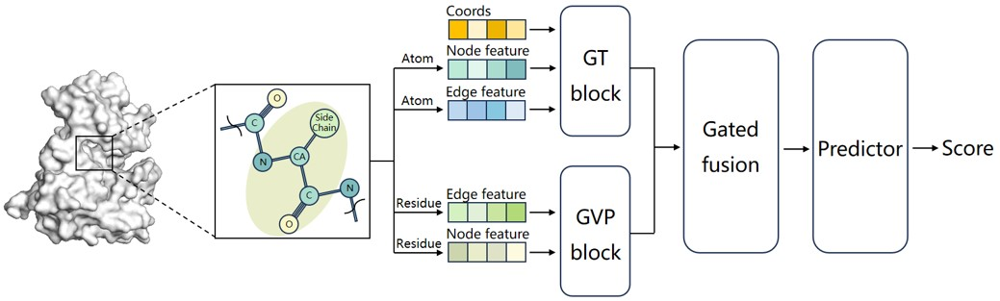

# DSProfiler: A Dual-Scale Graph Neural Network for Druggable Site Evaluation and Selection

## Contents
- [Overview](#overview)
- [Installation](#installation)
- [Demo 1: Druggability Evaluation for Targeted Sites](#demo-1-druggability-evaluation-for-targeted-sites)
- [Demo 2: Druggable Site Prioritization for Whole Protein](#demo-2-druggable-site-prioritization-for-whole-protein)
- [Evaluation](#evaluation)
- [Citation](#citation)

## Overview
Accurate druggability assessment is a prerequisite for enhancing early-stage drug discovery efficiency, yet conventional models often suffer from limited predictive accuracy and inherent performance degradation on apo structures. Here we propose DSProfiler, a dual-scale graph neural network framework designed for the robust evaluation and prioritization of druggable sites. The model implements an integrated architecture consisting of: (1) an atomic-level Graph Transformer encoder to capture electronic and physicochemical microenvironments; (2) a residue-level Geometric Vector Perceptron encoder to extract geometric and topological profiles; (3) a conditional gated fusion module to adaptively integrate multi-scale information. DSProfiler demonstrates leading performance in both classification and ranking tasks, with its practical utility further validated through the successful prioritization of allosteric sites and evaluation of protein–protein interaction (PPI) interfaces.

## Installation
### Clone the repository
```bash
git clone https://github.com/Ichigovo/DSProfiler.git
cd DSProfiler
```
### Set up the environment
```bash
conda env create -f environment.yml
```
### Install external pocket detection tools (Optional)
DSProfiler is compatible with various pocket detection tools (e.g., P2Rank, Fpocket). You may choose any tool depending on your requirements. Here, we provide an integration with P2Rank to demonstrate the complete workflow.
Note: Installation of P2Rank is only required for the Ranking Pipeline (Demo 2). If you only intend to run the Scoring Pipeline (Demo 1), you can safely skip this section.

**Official Installation**: 
   Please follow the [P2Rank Official Guide](https://github.com/rdk/p2rank) to download the tool and set up its required environment (naming it `p2rank`). Ensure that P2Rank can run successfully on your system.

**Setup for DSProfiler**: 
   Once P2Rank is installed, follow these steps to integrate it with our pipeline:
- Place the entire P2Rank directory into the root folder of this project and rename it to `run_p2rank`.
- Copy our provided parser script into that folder:
    ```bash
    cp ./utils/p2rank_parser.py ./run_p2rank/
    ```
## Demo 1: Druggability Evaluation for Targeted Sites
This demo provides a straightforward protocol for evaluating the druggability of targeted sites. By inputting raw protein structures and specifying pocket centers, users can obtain precise druggability scores for sites of interest.

We provide a set of example data in `./example/score/`. You can quickly run it by executing:
```bash
bash score_pipeline.sh
# Please check the results in the current directory.
```
To run the model on your own data, simply update the global parameters defined at the top of the score_pipeline.sh script. 

## Demo 2: Druggable Site Prioritization for Whole Protein
This demo implements an end-to-end pipeline that automatically performs pocket extraction and subsequent prioritization, allowing users to identify druggable sites directly from raw protein structures.

We provide a set of example data in `./example/rank/`. You can quickly run it by executing:
```bash
bash rank_pipeline.sh
# Please check the results in the current directory.
```
To run the model on your own data, simply update the global parameters defined at the top of the rank_pipeline.sh script.

## Evaluation
The evaluation methods used in our study are open-sourced in the `./evaluation/` directory to ensure the transparency and reproducibility of our results.

## Citation